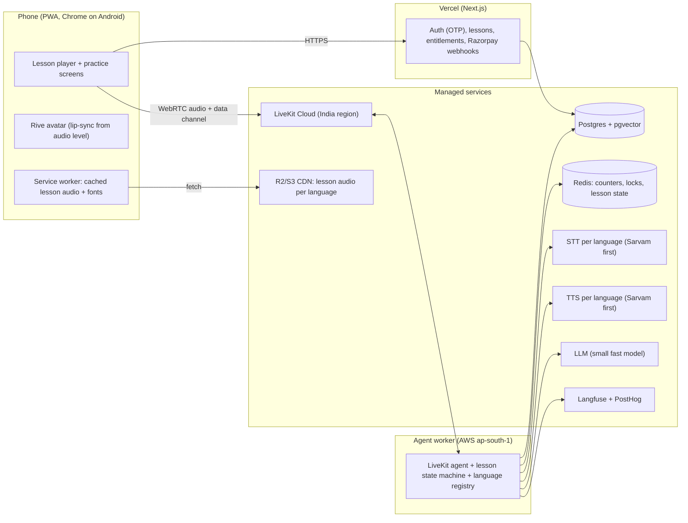

# AI Tutor: Architecture and Development Plan (v2)

Nov 23, 2026 · @Tata sheshank · v2 replaces the Nov 22 draft

Confidence tags: [Certain] verified or structural, [Likely] strong expectation, [Guessing] starting estimate to measure.

## What changed from v1

- **Languages:** Telugu is the primary language. Hindi and English ship alongside it. Every language-specific piece now sits behind a language registry, so adding a fourth language means adding config and content, not changing code.
- **Two language settings per learner:** *tutor language* (what the tutor speaks) and *screen language* (what the practice screens show, matching the learner's real phone).
- **Lesson format:** one shared lesson structure plus a reviewed text-and-audio pack per language.
- **Speech test:** now per language, Telugu first, with a separate go/no-go for each language.
- **New sections:** onboarding, accessibility, offline and weak-network behaviour, privacy and consent (DPDP Act), safety escalation, content review, device testing.
- **Timeline:** about 3–5 weeks longer, mostly content review and speech testing.

## Bottom line

[Likely] Fully live generated lessons will lose money at ₹50–100 per course, and will sometimes teach wrong taps to people who cannot spot the mistake. Make **scripted core with live interruptions** the default, and keep fully generated lessons behind a per-lesson flag for testing.

- **Cost.** [Guessing] A live voice pipeline costs roughly ₹2–5 per tutor minute. A 6-lesson course at 15 minutes each is 90 minutes, so ₹180–450 of AI cost against ₹50–100 of revenue. Scripted mode pays for the tutor's voice once per lesson version per language, not once per learner. Only interruptions use live minutes.
- **Correctness.** [Likely] A generated lesson will sometimes describe a menu that does not match the practice screen. In generated mode the model may only pick screens and tap targets from the screen library, and every lesson is validated before it plays.
- **The biggest build cost is not the AI.** [Likely] The practice screens and the reviewed Telugu, Hindi and English lesson content will take more of your time than the voice agent.
- **Speech recognition is the weakest link, and Telugu is the hardest case.** [Likely] Accuracy drops on older voices, slow speech, long pauses and mixed speech. Telugu-English mixing ("WhatsApp lo video call ela cheyali?") is how most of your learners will talk. Test it with 8–10 elderly Telugu speakers by week 4, before building lessons on top of it.
- **Timeline.** [Guessing] About 17–22 weeks full-time on Claude Pro to a Telugu-first pilot with one complete course in all three languages, or 13–17 weeks on Max 5x. Part-time roughly doubles both.

## Assumptions and scope

Phase 1 only: one course for elderly and first-time smartphone users, on a mobile-first PWA.

| Item | Assumption | Status |
| --- | --- | --- |
| Primary language | Telugu (te-IN), standard spoken Telugu understood across Andhra Pradesh and Telangana | Decided |
| Other launch languages | Hindi (hi-IN), Indian English (en-IN) | Decided |
| Future languages | Tamil, Kannada, Marathi and others, added through the language registry | Planned, not scheduled |
| Code-mixing | Learners mix English app words into Telugu and Hindi; the tutor does the same ("వీడియో కాల్ బటన్") | Design rule |
| Device | Low-end Android, Chrome, 3 GB RAM, patchy 4G | Assumed |
| Learners | 55+ first-time smartphone users in AP and Telangana first, often with a family helper nearby | From your brief |
| MVP content | One course: WhatsApp basics plus scam safety, 6–8 lessons, in te, hi, en | Proposed |
| Developer | You alone; strong in Next.js, new to WebRTC voice agents | Assumed |
| Payer | Learner or a family member (often an adult child), paying by UPI through Razorpay | Not validated |
| Lesson modes | Scripted core with live interruptions, and fully generated, switchable per lesson | Your decision |

Out of scope for v1: Windows and computer lessons, phase 2 and 3 audiences, a native app, a photoreal avatar, and languages beyond te, hi, en.

## Architecture

A Next.js app on Vercel handles everything that is not live audio. A long-running LiveKit Agents (TypeScript) worker in Mumbai handles every voice turn.



Key decisions:

- **Separate worker, not Vercel functions.** [Certain] Serverless functions have execution time limits and are not built to hold a WebRTC media session. Run the worker on a small VM in AWS Mumbai (ap-south-1) or similar, with LiveKit Cloud as the media server.
- **Lesson state in the worker.** The lesson runner lives inside the agent process, so a step change adds no network hop. Checkpoint its state to Redis on every step, and to Postgres at step boundaries, so a dropped call resumes at the same step.
- **Events over the data channel.** The worker sends `show_screen`, `highlight`, `avatar_state`, `resume` and `set_language`. The phone sends `practice_result`, `ask_pressed` and `tap_answer`. Practice taps are graded on the device.
- **Lip-sync from audio.** [Likely] Drive the Rive mouth from the tutor audio's loudness in the browser (Web Audio AnalyserNode). It works the same for cached and live audio in every language. Add visemes later only if testers notice.
- **One audio path.** In scripted mode the worker plays cached clips into the room, so barge-in behaves the same in both modes.
- **Providers per language, not one global choice.** The language registry picks the STT and TTS provider for each language. Sarvam is the first candidate for all three (it covers Telugu, Hindi and Indian English for STT and TTS). Second candidates: Google Cloud Speech (Chirp) and Azure Speech, both of which list Telugu. [Likely] Do not count on Deepgram for Telugu until you have checked current language support. Pick per language after M1.
- **Phone OTP** via an Indian SMS provider such as MSG91, with the OTP message template in all three languages (DLT registration needed for each template).

### Language registry

Every language-specific value lives in one typed config per language. Nothing else in the code branches on a language code.

```ts
// worker/src/languages/te.ts
export const te: LanguageConfig = {
  code: "te-IN",
  name: { native: "తెలుగు", en: "Telugu" },
  script: "Telu",
  status: "launch",               // "launch" | "beta" | "disabled"
  stt: { provider: "sarvam", model: "…", fallback: "google-chirp" },
  tts: { provider: "sarvam", voice: "…", speed: 0.85 },
  endpointingMs: 900,             // tuned in M1, per language
  vadThreshold: 0.6,
  codeMixing: ["en"],             // English words expected mid-sentence
  intentPath: "translate-to-en",  // classify intent on an English translation
  font: "Noto Sans Telugu",
  lineHeight: 1.7,
  numerals: "western",            // "1930", not Telugu digits
  uiStrings: "locales/te.json",
  safety: { helpline: "1930", reportUrl: "cybercrime.gov.in" },
};
```

**To add a language later:** add its config file, its UI strings, its locale pack for every lesson, a tutor voice, and pass the M1-style speech test with 5+ elderly speakers. The validator refuses to set `status: "launch"` while any published lesson lacks a reviewed pack for that language.

### Tutor language and screen language

| Setting | Values | Controls | Set when |
| --- | --- | --- | --- |
| Tutor language | te, hi, en (later more) | Tutor voice, scripts, live answers, quiz | Onboarding; changeable from settings, not mid-lesson |
| Screen language | The language the learner's real phone uses (often English) | Labels on simulated WhatsApp, UPI and settings screens | Onboarding: "Is your phone in English or Telugu?" with two screenshots to pick from |

Practice screens take their labels from the screen language. Tap targets use stable ids (`btn.videoCall`), so a Telugu tutor can teach on an English-labelled screen, and the grading never changes. The tutor's script refers to the label the learner actually sees ("ఆకుపచ్చ **Video call** బటన్ నొక్కండి").

## Onboarding

1. First screen: three large buttons, each in its own script and spoken aloud in turn: **తెలుగు**, **हिंदी**, **English**. Telugu is listed first and pre-highlighted.
2. Screen language: "Does your phone look like this, or like this?" with two pictures.
3. Mic permission, explained by the tutor before Chrome's prompt appears, with a picture of the prompt.
4. A 20-second sound check: "Say your name." It checks that the mic works and tunes the end-of-speech timeout for this learner.
5. Consent (see Privacy), read aloud, with one large tick button.
6. Optional family helper: a helper's phone number for progress updates and payment.

## Voice turn and latency budget

Target: the tutor starts answering within 1.8 s at the median and 3 s at p95. [Guessing] Under about 2 s feels like a patient teacher. Over 3 s, learners repeat themselves and the turns collide.

| Stage | Target p50 | Notes |
| --- | --- | --- |
| End-of-speech detection | 700–1000 ms | Elderly speakers pause mid-sentence. Start at 900 ms, tune per language in M1 and per learner during onboarding. |
| STT final transcript | 100–300 ms | Streaming STT, gated by VAD so you pay for speech, not silence |
| Intent + LLM first token | 300–600 ms | Small fast model, short prompt, prompt caching, runs in-process |
| TTS first audio chunk | 150–300 ms | Streaming TTS |
| Network and playout | 100–200 ms | Worker in Mumbai, LiveKit Cloud India region |
| **Total to first tutor audio** | **1.4–2.4 s** | All stage numbers are [Guessing] starting targets; measure them per language in M0 |

[Likely] Telugu and Hindi text uses several times more LLM tokens than the same sentence in English. Expect live Telugu answers to cost more and finish later than English ones. Streaming hides most of the delay; the token cap below limits the cost.

How one interruption runs:

1. The learner speaks or taps the big **Ask** button. The tutor's audio stops within 200–300 ms and the avatar switches to a listening pose.
2. The lesson runner saves the current step, so the lesson can resume exactly there.
3. The transcript goes to an intent check: answer to the practice task, question about this step, "repeat", "slower", off-topic, scam worry, or "I already lost money". For Telugu and Hindi, the check runs on an English translation of the transcript as well as the original, and the result is logged for comparison.
4. The runner answers with an authored line (cached audio) when one fits, otherwise with a short LLM answer in the tutor language, grounded in the current step and the lesson notes (pgvector).
5. TTS streams the answer back, and the data channel sends UI events such as highlight or show screen.
6. The tutor asks "Shall we continue?" and returns to the saved step.

Authored lines to record for every language before any live answer: "Repeat", "Slower please", "I didn't understand, tap your answer", "Let's continue", "One moment" (the acknowledgement clip), and the scam-help escalation.

Rules for this audience:

- [Likely] Always-on voice detection in noisy homes (TV, family talking) will trigger false interruptions. Use a high VAD threshold plus the Ask button, and confirm before abandoning a step.
- If a reply will take over 1.5 s, play a short cached acknowledgement so silence never looks like a crash.
- Every voice question also has a tap answer, so a learner the STT cannot understand still finishes the lesson.
- After two failed recognitions in a row, the tutor switches that step to tap-only and says so kindly.

A realtime speech-to-speech model is worth one A/B test, in English and Hindi first. [Guessing] It cuts latency to about 0.6–1 s and handles barge-in natively, but costs more per minute, gives less control over exact wording, and its Telugu voice is likely to sound less natural than an India-trained TTS.

## Lesson modes and lesson format

Both modes produce the same lesson JSON, so the player, the screens, the quiz and the cost caps do not care which mode made it.

| Mode | Who writes the steps | Tutor voice | Live AI used for | Cost per learner [Guessing] |
| --- | --- | --- | --- | --- |
| Scripted core + live interruptions (default) | You, with Claude's help, reviewed once per language | TTS generated at publish per language, cached on a CDN | Questions, "repeat", quiz grading | Low: only interruption minutes |
| Fully generated (flag per lesson) | LLM at session start, tailored to the learner | Streamed TTS for every line | Everything | High: every minute is live |

Rules that keep generated mode safe:

- The LLM fills the schema through structured output, and a zod validator rejects any `screen` or `target` that is not in the screen library manifest.
- Each simulated screen is a React component whose tappable parts carry stable ids (`data-target="btn.videoCall"`) and whose visible labels come from the screen-language string file. The same manifest feeds the validator and the LLM prompt.
- Generated mode is enabled per language. Start it in English, then Hindi; enable Telugu only after reviewing 20+ generated Telugu lessons.
- A generated lesson that passes validation is logged in Langfuse, so you can review it and promote a good one to scripted.

The lesson is one shared structure plus one locale pack per language:

```json
{
  "id": "wa-video-call-01",
  "version": 3,
  "course": "whatsapp-basics",
  "mode": "scripted",
  "objectives": ["start a video call", "switch camera", "end the call"],
  "screens": ["wa.chats", "wa.chat", "wa.call"],
  "interruptions": { "enabled": true, "maxLiveTurns": 8, "maxLiveSeconds": 180 },
  "steps": [
    { "id": "s1", "type": "say", "avatar": "smile" },
    { "id": "s2", "type": "show", "screen": "wa.chats", "highlight": "row.beta" },
    { "id": "s3", "type": "practice", "screen": "wa.chat",
      "expect": { "tap": "btn.videoCall" }, "maxAttempts": 3, "onFail": "demo" },
    { "id": "s4", "type": "check", "tapFallback": ["yes", "no"] }
  ],
  "quiz": [
    { "id": "q1", "kind": "voice" },
    { "id": "q2", "kind": "tap", "screen": "wa.chat", "expect": { "tap": "btn.videoCall" } }
  ],
  "knowledge": ["notes/whatsapp-calls"],
  "safety": { "neverSay": ["share your OTP"], "onScamWorry": "scam-help-01" },
  "locales": {
    "te": {
      "status": "reviewed", "reviewer": "…", "reviewedAt": "2026-…",
      "title": "వాట్సాప్‌లో వీడియో కాల్",
      "steps": {
        "s1": { "text": "…", "audio": "cdn/wa-video-call-01/v3/te/s1.mp3" },
        "s3": { "text": "…", "hints": ["…", "…"] },
        "s4": { "question": "…", "accept": ["అవును", "yes", "haan"] }
      },
      "quiz": { "q1": { "prompt": "…", "rubric": "…", "correction": "…" } }
    },
    "hi": { "status": "reviewed", "…": "…" },
    "en": { "status": "draft", "…": "…" }
  }
}
```

Step types: `say` (tutor speaks), `show` (screen plus highlight), `practice` (learner taps; graded on the device, no AI cost), `check` (quick spoken or tapped answer). `accept` lists include the code-mixed and English forms learners actually say.

Validator rules:

- Every step and quiz item has text in every locale whose `status` is `reviewed`.
- A learner can start a lesson only in a language whose locale pack is `reviewed`.
- Every `screen` and `target` exists in the screen library manifest.
- `neverSay` phrases are checked in every language's text, using a per-language phrase list.

### Content workflow

1. Write the lesson structure and English text with Claude (English is the source text, which also makes future languages cheaper to add).
2. Claude drafts the Telugu and Hindi text. Telugu is reviewed first, because it is the primary audience.
3. A native reviewer per language checks it for natural spoken style (not bookish Telugu), the right English loanwords, and correct scam advice. The reviewer listens to the generated TTS audio, not just the text.
4. Publish generates and caches the audio per language and per version.
5. Each lesson is tested with one real learner per language before the pilot.

Telugu style rules: everyday spoken Telugu that works in both AP and Telangana; keep app words in English as people say them (WhatsApp, call, button, OTP, UPI); respectful forms (మీరు); short sentences; numbers spoken as people say them, which is often in English for phone numbers and amounts.

## Accessibility for elderly learners

- Base font 20 px, scalable to 28 px. Telugu needs taller line height (about 1.7) or its vowel signs collide.
- Self-host Noto Sans Telugu and Noto Sans Devanagari, subset, cached by the service worker. [Likely] Some cheap Android phones render Telugu poorly with system fonts.
- Tap targets at least 56 px; one primary action per screen; high contrast; no swipe-only gestures.
- Tutor speech at 0.85x by default, with a "slower" voice command and button.
- Every screen has a visible "Repeat" and "Ask" button.

## Weak network and offline behaviour

- The service worker caches the next lesson's audio, screens and fonts on Wi-Fi.
- If WebRTC drops or bandwidth is too low, the player continues the scripted lesson from cached audio, with tap answers only, and shows "Ask the tutor when you're back online".
- On reconnect, the lesson resumes from the checkpoint; the learner never restarts a lesson because of the network.

## Data model and AI cost guardrails

Every live second is counted in Redis while it happens and written to Postgres when the run ends, so no learner and no bad day can run up an open-ended bill.

Core tables in Postgres:

- `users`: phone, tutor_language, screen_language, endpointing_ms, plan, helper_phone
- `consents`: user, version, language, accepted_at, recording_opt_in
- `languages`: code, status, providers (mirrors the registry for admin use)
- `courses`, `lessons` (structure JSON, version, mode), `lesson_locales` (lesson, version, language, status, reviewer, reviewed_at, audio_manifest)
- `lesson_runs`: language, mode, live_seconds, estimated_cost, resumed_count, network_fallbacks
- `turns`: transcript (redacted), language, detected_language, intent, stt_confidence, latency, tokens
- `quiz_attempts`, `entitlements` (Razorpay payment id), `lesson_notes` with pgvector embeddings, one row per language

| Guardrail | Starting value [Guessing] | Where it is enforced | What the learner hears when it trips |
| --- | --- | --- | --- |
| Live minutes per user, free | 20 min/day | Redis counter, checked by the agent each turn | "Let's continue tomorrow"; scripted replay still works |
| Live minutes per paid course | 120 min total | Redis + `entitlements` | Offer scripted replay, or a top-up |
| Live turns per lesson run | `maxLiveTurns` 8, `maxLiveSeconds` 180 | Lesson JSON, agent | "Let's finish the lesson first, then ask me" |
| Answer length | ~60 words (~40 for Telugu), ~25 s audio, max tokens capped per language | LLM call settings | Nothing; answers stay short |
| Idle and session limits | Leave room after 60 s silence; 30 min per room | Agent worker | "I'll wait here, tap to continue" |
| Global daily spend | e.g. ₹2,000/day in testing; alert at 80% | Redis cost counter, Langfuse | At 100%, new sessions start scripted-only |
| Provider hard caps | Monthly budget in every provider console | Provider dashboards | Last line of defence |
| One live session per user | 1 | Redis lock at room-token mint | Second device is told the lesson is open elsewhere |

Cost levers that matter most, in order:

1. Cache all authored tutor audio at publish time on a CDN, per language. It is generated once per lesson version per language, not per learner.
2. Prefer authored lines over live answers, especially in Telugu, where live answers cost the most tokens.
3. Route models by job: a small fast model for intent checks and answers, a larger one only for generating lessons.
4. Grade practice taps on the device. They never touch an AI service.
5. Track cost per learner-minute per language in PostHog from the first pilot user, and set the course price from that number.

## Privacy, consent and safety

- **Consent under the DPDP Act 2023.** [Likely] Voice recordings and transcripts are personal data. Ask for consent in the learner's language, read aloud, before the first live turn. Recording for product improvement is a separate opt-in. M1 test recordings need written consent too.
- **Data location.** Keep Postgres, Redis, the worker and audio in India (ap-south-1). Check each speech provider's data retention settings and turn off training on your data where offered.
- **Redaction.** Scam-worried learners may read out an OTP, card number or UPI PIN. Redact digit runs of 4+ in stored transcripts and Langfuse traces.
- **Retention.** Raw audio deleted after 30 days unless opted in; transcripts kept redacted; a "delete my data" request handled within 30 days.
- **Scam escalation.** If the intent is "I already shared an OTP" or "I lost money", the tutor plays an authored script, never an LLM answer: call 1930 (national cyber crime helpline) now, call your bank, report at cybercrime.gov.in, and tell a family member. If a helper phone is set, offer to notify them.
- **Advice sources.** Base scam-safety lessons on RBI, CERT-In and the national cyber crime portal; date-stamp each lesson and review quarterly.

## Device and quality testing

- Test devices from week 1: one ₹7,000 Android (3 GB RAM), one mid-range phone, Chrome stable.
- Check on each: Telugu font rendering, Rive frame rate during live audio, mic echo cancellation with the phone speaker, and battery use over a 15-minute lesson.
- Per-language test sets: 50 recorded learner utterances per language from M1, rerun on every STT or prompt change to catch regressions in intent accuracy.

## Milestones for a solo developer

[Guessing] Six milestones, about 19 weeks full-time on Pro. Each ends at a gate you can test, not a feature list.

| Milestone | Weeks (Pro, full-time) | Gate |
| --- | --- | --- |
| M0 Trilingual voice loop | 1–2 | Telugu, Hindi and English conversations work on a cheap phone, with barge-in, under 2.4 s median |
| M1 Speech reality check | 2–4 | Intent understood for 85%+ of elderly test utterances, per language |
| M2 Lesson engine | 5–9 | One lesson plays end to end in all three languages, with resume and screen language switching |
| M3 First course | 9–14 | 6–8 lessons with reviewed Telugu packs; Hindi and English packs reviewed by week 14 |
| M4 Product shell | 14–17 | A stranger can sign up, pay, learn and hit a cap safely |
| M5 Pilot | 17–20 | 20–30 learners complete the course; cost per learner known per language |

The week 4 gate is the one to respect, and it is per language. If STT cannot understand your Telugu testers, make Telugu tap-first with voice as a bonus, and keep voice-first for languages that pass. One language failing does not block the others.

What each milestone delivers:

1. **M0 Trilingual voice loop.** A LiveKit agent in Mumbai with the language registry from day one. It hears you, answers in Telugu, Hindi or English through streaming STT and TTS, stops when interrupted, and moves a Rive mouth on a cheap Android phone. Latency measured per language.
2. **M1 Speech reality check.** Recordings from 8–10 elderly Telugu speakers (both AP and Telangana), 5 Hindi and 5 English speakers, with written consent. Include code-mixed phrases, long pauses and TV background noise. Run them through 2–3 providers per language (Sarvam, Google Chirp, Azure) and score whether the intent was understood, with and without English translation. Pick providers and endpointing per language.
3. **M2 Lesson engine.** The lesson schema with locale packs, the zod validator, the lesson player, the lesson state machine with resume, the publish step that caches TTS audio per language, the onboarding flow, offline fallback, and 3 practice screens with screen-language labels.
4. **M3 First course.** 15–20 practice screens, 6–8 lessons (WhatsApp basics and scam safety), native review in Telugu first, then Hindi and English, the voice quiz with corrections, the scam escalation script, and generated mode behind its flag (English first).
5. **M4 Product shell.** Phone OTP with DLT templates in three languages, Razorpay and entitlements, consent and data deletion, minute caps and the daily kill switch, Langfuse and PostHog, and PWA install.
6. **M5 Pilot.** 20–30 learners, weighted to your audience: about 20 Telugu, 5 Hindi, 5 English. Weekly fix cycle, and a comparison of the two modes on completion and cost, per language.

## Timeline: Claude Pro vs Max

[Guessing] Pro gets you to a pilot in about 17–22 weeks full-time; Max 5x saves about 4–5 weeks for roughly $250–300 more over the build.

Pro will throttle you. [Likely] Claude Code on Pro shares a usage limit that resets every 5 hours, plus a weekly cap. A heavy agentic session can use a 5-hour window in 1–2 hours, after which you wait or code by hand. Plans and limits change, so check [claude.ai/pricing](https://claude.ai/pricing) before you decide.

| Plan | Price [Likely] | What it means for you | Full-time to pilot [Guessing] | Part-time, 15 h/week [Guessing] |
| --- | --- | --- | --- | --- |
| Pro | $20/month | Several forced pauses a week during heavy build phases | 17–22 weeks | 8–11 months |
| Max 5x | $100/month | About 5x Pro's usage; rarely blocked as one developer | 13–17 weeks | 6–8 months |
| Max 20x | $200/month | Room for parallel agents; little extra gain for one person | 12–16 weeks | 6–8 months |

Why Max does not halve the time: [Likely] the slowest parts are things Claude cannot speed up: sessions with elderly testers, native review of Telugu and Hindi scripts, tuning STT on real voices, testing on cheap phones, DLT template approval and Razorpay activation.

What I'd do: start on Pro for M0 and M1 (spikes, more reading and testing than code). Upgrade to Max 5x for M2 to M4, where most of the code gets written. Drop back to Pro for the pilot.

To stretch Pro:

- Plan each feature in chat first, then give Claude Code small, scoped tasks.
- Keep `CLAUDE.md` short and run `/clear` between unrelated tasks.
- Build one screen template first, then have Claude copy it for each new practice screen.
- Use Sonnet for routine code and save Opus for the agent worker and the lesson runner.
- Run only the failing tests while fixing, not the whole suite each time.

## Risks

| Risk | Likelihood | Mitigation |
| --- | --- | --- |
| STT fails on elderly Telugu speech | High [Likely] | Week 4 test per language; tap answer for every voice question; Telugu can go tap-first alone |
| Code-mixed speech misclassified | High [Likely] | Intent check on original and English translation; `accept` lists with mixed forms |
| Live Telugu answers are weak or unnatural | Medium to high [Likely] | Authored lines first; short grounded answers; native review of logged answers weekly |
| Noisy homes trigger false interruptions | High [Likely] | Big Ask button, high VAD threshold, confirm before leaving a step |
| AI cost per learner exceeds the course price | High in generated mode [Likely] | Scripted default, minute caps, per-language token caps, daily kill switch |
| Generated lessons teach wrong steps | Medium [Likely] | Schema and screen-library validation; generated mode English-first; review before reuse |
| Native reviewers become the bottleneck | Medium [Likely] | Line up a Telugu reviewer before M3; batch reviews per lesson |
| WhatsApp or UPI apps change their UI | Medium [Likely] | Version screens; review the course every quarter |
| Rive plus WebRTC is slow on cheap phones | Medium [Guessing] | Test on a ₹7,000 Android phone from week 1; static avatar fallback |
| Telugu text renders badly on old phones | Medium [Guessing] | Self-hosted Noto Sans Telugu; check in week 1 |
| Scam-safety advice is wrong or out of date | Low to medium [Guessing] | RBI, CERT-In, cyber crime portal guidance; date-stamp lessons; native review |
| Privacy complaint over voice data | Low [Guessing] | Consent, redaction, India data location, deletion on request |

## Decisions only you can make

- [x] Languages: Telugu primary; Hindi and English at launch; others later through the registry.
- [ ] Tutor persona: one character with three voices, or a different character per language? Voice, gender and age for the Telugu tutor first.
- [ ] Who pays: the learner, a family member, or a sponsor such as a bank or CSR program. In AP and Telangana, an adult child paying for a parent is the likeliest first buyer [Guessing].
- [ ] Telugu reviewer: who reviews the Telugu scripts (needed by week 9).
- [ ] Pilot recruitment: where you find 20 Telugu-speaking elderly learners (family network, a senior citizens' association, a community centre).
- [ ] Keep LangGraph? I'd use a typed state machine for scripted mode: simpler and no framework overhead. LangGraph earns its place in generated mode only. If you keep it, run it inside the agent worker, never on Vercel.

## First two weeks, concretely

1. Set up the repo: Next.js app, agent worker, shared `packages/schema` (zod lesson schema + language registry types).
2. Create `te.ts`, `hi.ts`, `en.ts` language configs with Sarvam STT and TTS.
3. Get a LiveKit agent answering in Telugu on your own phone, with barge-in. Then Hindi and English by changing only the config.
4. Log latency per stage per language to a simple table.
5. In parallel: recruit M1 testers (Telugu first), prepare the consent form, and write the 30 test phrases per language, including code-mixed ones.
